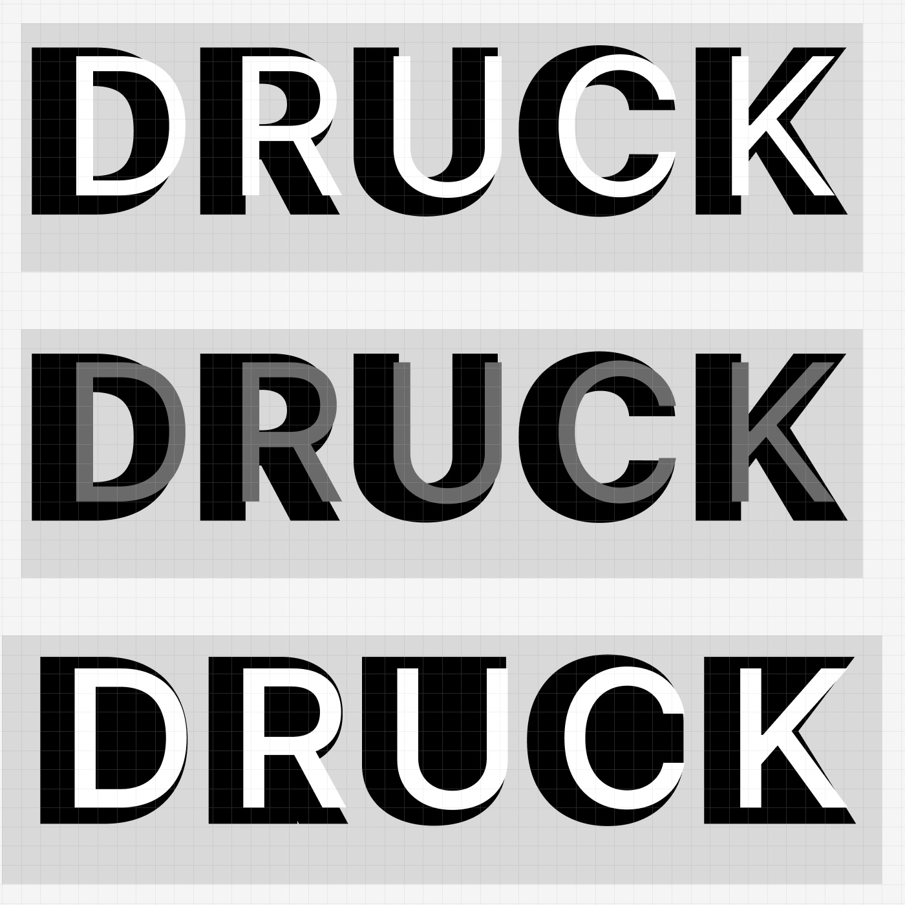
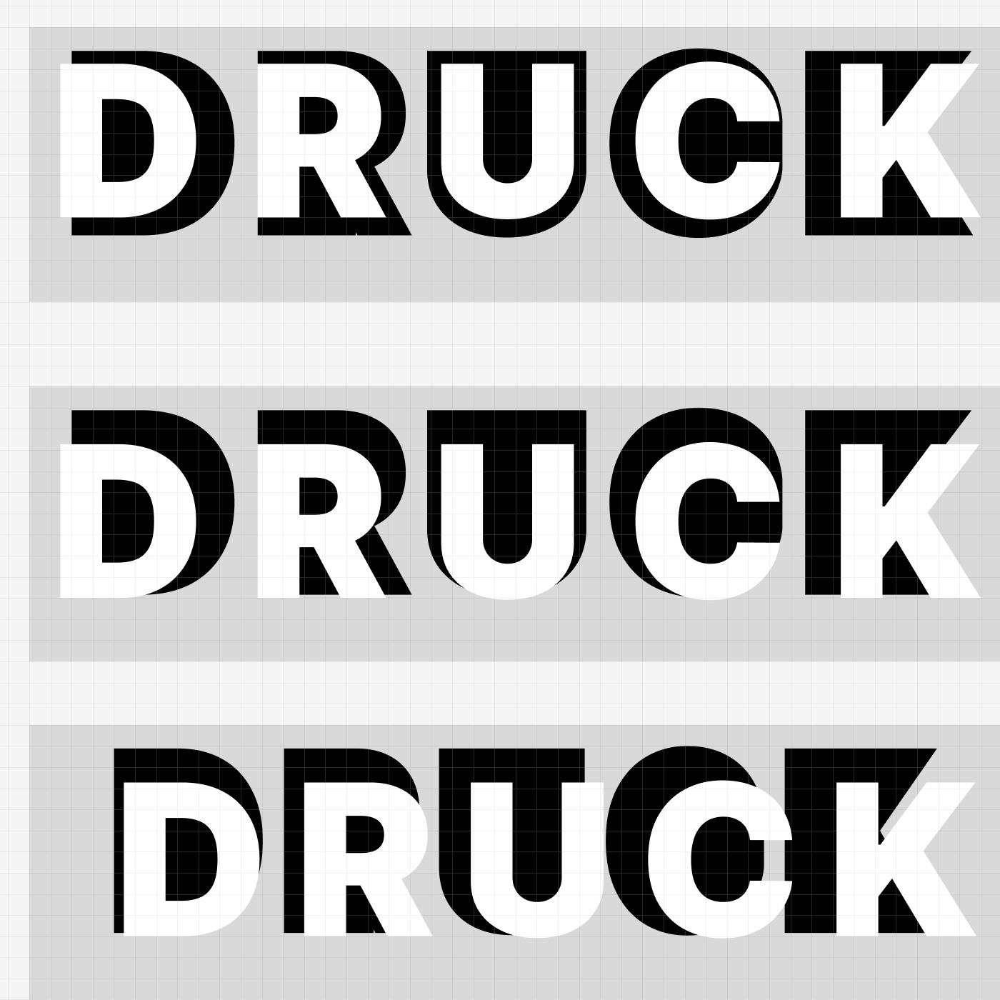
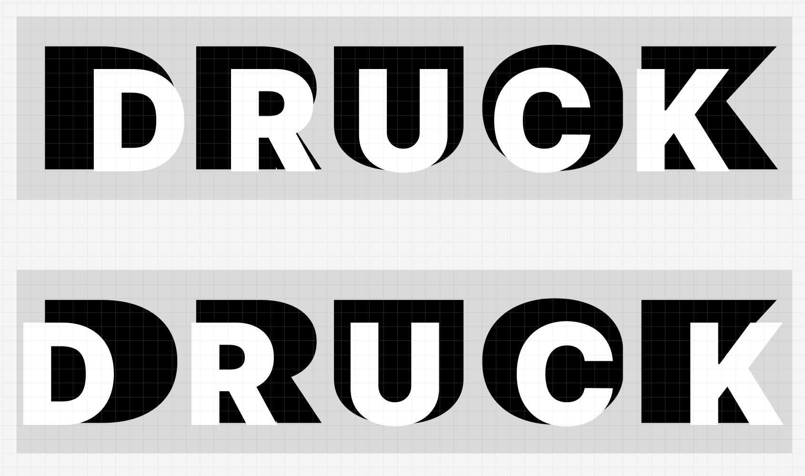
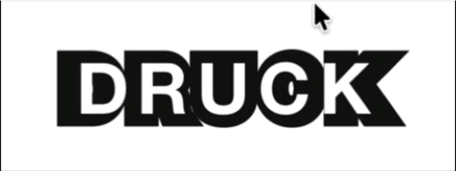

Earlier, I got the idea of placing the letter D inside a bigger letter D centred vertically. It was so visually appealing in my head, so I decided to play around it.

First, I didn't like how the letters of different weights overlapped; the angles became inconsistent, and that's annoying.

Second, I remembered that I wanted the 'letters' in the background to rather be polygons with contours outlining the letter in the foreground instead (3).

I kept looking and discovered that the effect I was after was achieved by varying the spacing between the front and back texts. I feel that text like “poster-like” and three-dimensional -- likely because the text behind is perceived as a shadow.

I tried to make it a bit wider -- cool. I became curious: is it possible to bring it to the web?

The first (bad) thing I've found is the fact that browsers/CSS cannot 'polygonise' the letters. But a very similar effect is possible to reach with massive outlines.

Lastly, I took some time to animate it; the result is below:

